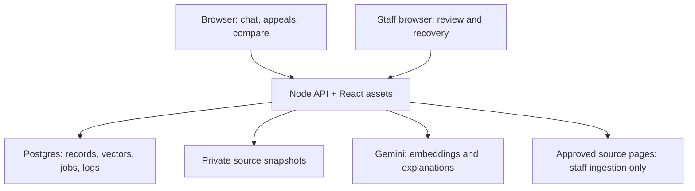

# ReliefCheck — system design and AI implementation contract

Version: 1.0 • Design date: November 5, 2026 • Team 5

**Read this file before implementing any story.** This is the shared implementation specification, not proof that the application has already been built or tested. MUST means a release requirement; SHOULD means the default unless a documented reason changes it. Numbers labeled initial are tuning values, not measured results.

## 1. Purpose, source of truth, and limits

Build a hosted RAG application for individual donors and community fundraising organizers researching disaster relief appeals. Initial events: the October 2024 Valencia DANA floods and October 2025 Hurricane Melissa in Jamaica. Solve the repeated problem of locating documented channels and warnings across disasters, rather than responding to only one event.

Source requirements: the attached `ReliefCheck_Team_Review_Packet(1).pdf`, especially scope, US01–US14, responsibilities and sprint commitments; the three attached assignment screenshots covering context, design guidelines and required stories. Preserve their story IDs and owners. This design adds implementation decisions; it does not imply that the TA has approved those decisions. The PDF's final TA section does not provide readable approval terms in extracted text. Obtain and record actual TA preferences rather than inventing them.

The product provides evidence, not certification. It cannot guarantee that a charity, page or transaction is safe. A reviewed official hostname does not authenticate a forwarded message, payment destination, individual fundraiser, or every path hosted on that domain. A historical warning is not proof of a present threat. No record is proof of absence of fraud.

### Non-negotiable invariants

1. Gemini MUST NOT assign or change an appeal status, official hostname, source authority, review date, expiry, or organization identity.
2. Public answers retrieve only from a published, reviewed corpus. Drafts and failed builds are never searchable.
3. Every source-specific factual claim must have supporting evidence. A citation ID being valid does not prove entailment; evaluate content separately.
4. Disaster isolation applies to structured lookup, lexical search, vector search, comparison, and citations—not just the prompt.
5. Current channel eligibility is calculated at request time from reviewed data and expiry. Historical records remain visibly historical.
6. No submitted appeal URL is fetched. Only authenticated, constrained ingestion can access approved sources.
7. Anonymous users cannot mutate data, see drafts, run ingestion, or access usage logs. Backend authorization is mandatory.
8. Secrets, unpublished documents and personal donor information MUST NOT enter client bundles, Git, logs, or Gemini prompts.
9. No paid services, paid model fallback, credit-card-dependent trials, paid reranker, or paid search API. If a free dependency is unavailable, show degradation or stop; do not enable billing.
10. All knowledge-base changes publish atomically, retain provenance, and invalidate older in-flight results before release to the user.

### MVP boundaries

Included: hosted chat; cited answers; two ingestion paths; review/publish controls; deterministic appeal review; structured channel comparison; runtime prompt modes; evaluation; website monitoring, logs, clear and reload.

Excluded: payments, fraud probability scores, automated legitimacy certification, live crawling of submitted links, open web search, autonomous agents, OCR, arbitrary web crawling, user accounts for donors, persistent personal chat history, live disaster alerts, and automated translation of authoritative records. English UI initially; retain original source language. Spanish retrieval must be tested with the actual Valencia corpus.

The proposed scale is a classroom demonstration: up to 100 documents, 2,000 chunks per published release, two retained complete releases plus one staging release, at most 5 simultaneous interactive requests, and 2–4 organizations per comparison. These are product limits, not vendor entitlements. Larger datasets require renewed capacity measurements.

## 2. Architecture: one application, one database, one AI provider

| Layer | Decision | Why |
| --- | --- | --- |
| UI | React + TypeScript + Vite; React Router; plain CSS design tokens | Shared language and explicit screens without a second web framework |
| API | Node.js supported LTS, Express, TypeScript, Zod contracts | One deployable monolith; direct control over validation, network fetches and bounded ingestion |
| Hosting | One Render Free web service serving built UI and `/api/v1` | Same origin; no CORS deployment split; free demonstration hosting |
| Database | Supabase Free PostgreSQL with pgvector and PostgreSQL full-text search | Structured facts and retrieval in the same transactional database |
| Files | Private Supabase Storage bucket | Durable source snapshots; Render disk is temporary |
| Staff authentication | Supabase Auth, pre-provisioned individual staff accounts | No custom password storage or public signup flow |
| AI | Gemini Developer API through official `@google/genai` SDK | Only external AI provider available |
| Generation | Initial candidate `gemini-2.5-flash-lite`, configurable server-side | Use only if still available to the actual project's free tier |
| Embeddings | Initial candidate `gemini-embedding-001`, 768 dimensions | Multilingual semantic retrieval; compact vectors |
| Tests | Vitest + API integration tests + Playwright; local Postgres/pgvector | Free, meaningful verification of service boundaries |

Model availability is a **bootstrap gate**, not an assumption about the user's key. Before implementation depends on a model, verify the key can perform one embedding and one structured generation call without billing. Record model IDs, actual project quotas and date in `docs/provider-verification.md`. If either candidate is unavailable, select another verified free Gemini model and update the embedding profile / evaluation. Do not silently change models in production.



All browser application data goes through the Node API. Browser access to Supabase is limited to staff authentication. Database queries use `pg` with bound parameters, TLS verification, and a dedicated restricted application role over the supported Supabase pooler endpoint. Start with a pool of 3 connections; use the session pooler if direct IPv6 connectivity is unavailable. Migration credentials are different and never used by request handlers.

Application tables live in a private `relief` schema not exposed through the Supabase Data API. Revoke `PUBLIC`, `anon`, and `authenticated` table/function access and set equivalent default privileges for future objects. Grant only required table operations to the server role. RLS is defense in depth, not a replacement for server checks; do not assume service-role credentials obey RLS. Storage service credentials stay on the server; the bucket has no public read/write policies. Staff JWTs never confer raw database access.

### Cost and availability decisions

Render documents free-service sleep after 15 idle minutes, ephemeral local disk and 750 free instance hours per workspace per month. Its free Postgres expires; do not use it for durable application data. Supabase currently lists 500 MB database and 1 GB storage for Free, with inactivity pausing. These make a demo feasible, not an always-on production service [R1–R2].

Set internal warning thresholds at 300 MB DB and 500 MB object storage; stop new builds at 350 MB / 600 MB, leaving space for rollback, logs and operations. Track real size rather than estimating from source files. 2,000 vectors × 768 × 4 bytes is about 6.1 MB of numeric payload per release; text, row overhead and indexes add to that.

Keep every account on its free plan, disable paid add-ons and automatic upgrades, and inspect bandwidth/build quotas before the demo. Do not use fake keep-alive traffic to defeat idle policies. A normal manual pre-demo readiness check is appropriate. Show a retryable unavailable state if hosting or the database is paused. No promise of uninterrupted service.

## 3. Domain model: curated facts and source prose serve different jobs

**Structured registry:** exact disaster/channel/warning facts, publication dates, review dates, supported needs and limitations. This determines US13 and US14.

**Retrieval corpus:** cleaned source passages with provenance. This explains facts and answers general questions. Similarity never establishes identity or legitimacy.

**Metadata:** deterministic or human-reviewed first. AI-generated suggestions are optional future work, never an MVP dependency. Dates come from a source and reviewer; review time is a server timestamp for a real review. Do not synthesize a publication date when one is absent. AI cannot upgrade `unknown` to `official`.

### Relational contract

Use UUID primary keys, `timestamptz` UTC for instants, SQL `date` for source dates without a known time, JSONB only for bounded configuration or audit payloads, and normalized joins for filterable relationships. API fields are camelCase; SQL fields are snake_case. Never use display names as foreign keys.

| Table | Required fields and constraints |
| --- | --- |
| `disasters` | `id`, unique `slug`, name, country codes, event date/range; seed Valencia and Melissa explicitly |
| `organizations` | `id`, unique stable internal slug; display fields reside in versioned campaign records |
| `needs` | `id`, unique slug and label; initial vocabulary food, water, shelter, healthcare, sanitation, recovery; add only reviewed terms |
| `staff_roles` | `user_id` from Auth, role `developer` or `admin`, enabled; bootstrap out of band; no self-assignment |
| `sources` | `id`, canonical provenance URL or upload identifier, method `web`/`file`, created_by; no raw user appeal content |
| `source_versions` | source_id, SHA-256, private object key, MIME type, byte size, extraction_version, cleaned text, language, title, publisher, publication_date nullable, retrieved_at, review state, reviewed_by/at, authority category; unique source_id + content hash + extraction_version |
| `source_disasters` | source_version_id + disaster_id composite primary key; explicit reviewed applicability |
| `campaign_versions` | logical campaign_id, version id, disaster_id, organization_id, display_name, official_channel_url, normalized_hostname, match_scope `host`/`exact_url`, supported-needs joins, limitations, effective_from/until nullable, reviewed_at/by, review_expires_at, state; immutable after approval |
| `campaign_needs` | campaign_version_id + need_id; every positive need entry must reference a supporting evidence link |
| `warning_versions` | logical warning_id, version id, disaster_id, warning title, exact normalized host or exact URL, match_scope, publication_date nullable, historical text, retraction/supersession metadata, reviewed_by/at; immutable after approval |
| `record_evidence` | campaign/warning version reference (exactly one), source_version_id, page/section locator, supporting excerpt, field_key; supports each material structured assertion |
| `releases` | id, parent_release_id nullable, status `building`/`ready`/`published`/`retired`/`failed`, embedding_profile_id, manifest hash, created_at/by, failure code |
| `release_sources`, `release_campaigns`, `release_warnings` | release_id + version_id unique; freeze exact membership; no mutable latest-version joins |
| `chunks` | id, source_version_id, chunker_version, ordinal, text, text hash, locator (page or heading), embedding_input_hash, generated simple-config `search_vector` tsvector; unique source_version_id + chunker_version + ordinal |
| `release_chunks` | release_id, chunk_id, disaster_id; unique triple; supports filtered retrieval without cross-disaster leakage |
| `embedding_profiles` | id, provider, exact model id, dimensions=768 initially, normalization version, document/query task types, input-format version |
| `chunk_embeddings` | chunk_id + profile_id unique, vector(768), created_at; require finite nonzero normalized vectors |
| `kb_state` | singleton row, nullable active_release_id, monotonically increasing epoch, updated_at/by |
| `ingestion_jobs` | id, build/release id, state, stage, cursor, attempt_count, lease_owner, lease_until, last_error, input hash, cancellation flag, created_at/by |
| `request_events` | request_id, timestamp, endpoint, mode, status_code, error_code, latency_ms, stage timings, release_id, epoch, retrieval_mode, provider usage when available; no raw question, token or submitted URL |
| `audit_events` | actor UUID, timestamp, action, object/version IDs, outcome; bounded safe change metadata, no secrets |
| `quota_buckets` | provider/model/operation/time-window key, used/reserved units, reset_at; atomic admission counters |
| `request_keys` | hashed session scope + request UUID, input hash, running/completed state and lease, expiry; suppress retries; do not store full private response |

DB constraints enforce positive lengths, max field sizes, nonempty review evidence, `review_expires_at > reviewed_at`, and FK integrity. Release activation validation additionally checks that every registry evidence source and all required chunk embeddings belong to that release. Maintain ordinary B-tree indexes on release/disaster joins, normalized hosts, job state/lease and log timestamps; a GIN index on chunk lexical search vectors. No vector ANN index for the MVP.

The initial freshness policy is **30 days after a human channel review**, capped sooner by a documented campaign end date. This is a conservative product policy for TA review, not a guarantee of validity. Historical evidence is still useful after expiry, but must not be presented as a current donation channel. Warnings preserve original dates and retraction status; they are displayed as published warnings, not automatically ongoing threats.

## 4. Ingestion, review and atomic publication (US05–US07)

### Two genuinely distinct methods

1. **File upload:** staff upload UTF-8 TXT, Markdown, or text-based PDF. Validate MIME and magic bytes; at most 2 MB, 30 PDF pages and 100,000 extracted characters. Extract PDF text page-by-page with a pinned, tested PDF.js adapter. Reject encrypted, image-only, malformed or extraction-empty PDFs with an actionable message; no hidden OCR fallback.
2. **Reviewed web-page extraction:** staff choose an approved HTTPS source URL. Fetch plain HTML, extract article/main content with a tested Readability adapter, and preserve title, headings, source URL and snapshot. No JavaScript execution, browser automation, paywall bypass or site-wide crawling. Respect access restrictions and source licensing. If blocked, staff may upload an authorized copy with the original provenance.

Both adapters return the same typed `ExtractedDocument`: `{sourceId, contentHash, title, language, publicationDate|null, retrievedAt, blocks:[{text,page|null,heading|null}], warnings:[]}`. Adapter-specific code must not insert searchable chunks directly.

### Safe web fetching

Only developers/admins can ingest; require a configured allowed source hostname and a registered approved URL. HTTPS only, port 443, no URL credentials. Reject localhost, IP literals, private, loopback, link-local, multicast, reserved and IPv4-mapped private IPv6 addresses. Resolve DNS, validate every returned address, and pin a validated address to the actual connection while preserving hostname TLS verification. Revalidate each redirect; allow at most 3 and only within approved hosts. Prevent DNS-rebinding TOCTOU bugs; checking DNS and then using ordinary unrestricted `fetch` is insufficient.

Use a network timeout, compressed and decompressed byte caps, and an HTML content-type allowlist. Do not follow links found inside the HTML. If secure address-pinned fetching cannot be implemented and tested on the host, restrict this adapter to a small fixed server-configured URL manifest until it can; do not ship arbitrary URL entry.

### Pipeline and human gate

`queued → extracting → awaiting_review → chunking → embedding → validating → ready → published`

Any processing stage may become `retryable_failed`, `failed` or `cancelled`; review can reject it. UI shows stage, counts, last error and Resume/Cancel. No automatic publication.

1. Save validated raw bytes to private Storage; record SHA-256. Duplicate uploads return the existing job/version when content and extraction version match. A changed source creates a new immutable version.
2. Extract text; normalize Unicode NFC and whitespace, preserve dates, negations, amounts, hostnames and warnings. Remove navigation/script/style boilerplate and identical repeated lines without deleting meaningful repeated table headers. Flag tables or broken reading order for human review.
3. Staff inspect original vs extracted preview, source metadata, disaster tags, authority, and publication date. Missing data stays null. Approval records the actual reviewer and time. Approval is required for source prose as well as structured records.
4. Staff create/approve campaign and warning records with exact supporting excerpts. A newspaper is a warning/context source; it cannot automatically establish an organization's current official channel. Official attribution needs reviewed primary evidence.
5. Chunk by paragraph/heading with initial target 1,500 characters, maximum 2,400 characters, and up to 200 characters overlap. These are character counts, not claimed Gemini token counts. Never cross source versions or merge opposing statements out of context. Preserve page boundaries/locators and attach metadata separately. Clamp long paragraphs at sentence boundaries; test Spanish text.
6. Embedding input is a versioned deterministic template: title, heading, language, then verbatim chunk body. Disaster identity is enforced through relational metadata, not guessed from embeddings. Do not prepend AI-generated summaries.
7. Embed approved chunks with `RETRIEVAL_DOCUMENT`; query vectors use `RETRIEVAL_QUERY`. Set output dimensionality to 768; L2-normalize both sides for `gemini-embedding-001`. Reject wrong dimension, NaN, infinity or zero norm [R3].
8. Store embeddings idempotently by chunk/profile. Reuse unchanged source/chunk/profile data. Model or input-template changes require a new embedding profile and a complete compatible release.
9. Build a manifest of source versions, campaign/warning versions, chunk IDs, profile and hashes. Validate constraints, both event coverage and retrieval smoke tests. A normal full release needs both events; clear is a separate null-active operation.
10. An admin publishes a ready release in one short DB transaction: lock `kb_state`, verify expected epoch, validate ready status, switch active release, increment epoch, mark old release retired, audit. Never hold the transaction open during extraction or Gemini calls.

### Work execution on free hosting

Do not assume an always-running background worker or durable process memory. The website drives durable, resumable jobs. `POST /admin/jobs/:id/advance` atomically claims a lease, performs one bounded stage or at most five embedding calls, persists progress, and responds within a 20-second wall-clock budget. The admin page requests the next step only after the prior step resolves; closing the page pauses processing. Show this clearly. There is no promise that a job continues while the site sleeps.

Use 60-second leases with a unique owner token, stage deadlines and CAS updates checking that token. Expired leases are reclaimable. Embed one chunk per call initially; do not assume free batch-API availability. A crash after provider success but before persistence can duplicate a call on resume; exactly-once external requests are not promised. Unique keys prevent duplicated data. Retry quota exhaustion after the recorded reset time, not a tight loop.

## 5. Retrieval design: filtering, cosine similarity and ranking

### Per-query sequence

1. Validate question (1–2,000 characters), mandatory disaster ID, mode and optional selected organization IDs. One event per request. For questions about both events, ask the user to select an event; cross-event comparison is outside the MVP.
2. Read active release ID and epoch. If null, return `kb_unavailable` with no generation call. Capture the current time for freshness calculations.
3. Route requests containing URL evidence into the deterministic appeal service. For generic factual questions, resolve only exact curated organization aliases; ambiguous names cause a clarification. Do not impose a guessed organization filter.
4. Retrieve structured records relevant to the route. Hard-filter all retrieval to captured release and selected disaster. For current-channel questions, use only currently eligible campaign records and their supporting sources; generic historical questions may use historical prose with dates.
5. For eligible factual queries, request a query embedding. Run two ranked searches over the same eligible chunk set: exact cosine search top 20 and lexical search top 20. Use PostgreSQL `websearch_to_tsquery('simple', $question)` over a `simple` text vector for a multilingual baseline. This sacrifices language-specific stemming; evaluate Spanish and English questions explicitly. Lexical search is not the identity-matching engine.
6. Fuse rankings with reciprocal rank fusion, then deduplicate overlap and limit to at most 2 chunks per source, at most 6 chunks total. Expand to another source only when relevant evidence exists; never manufacture diversity.
7. Give the model bounded evidence and structured facts. Recheck epoch and current-channel eligibility before returning the response. If knowledge changed mid-request, discard output and return retryable `KB_CHANGED`; do not release withdrawn evidence.

### Mathematical contract

For nonzero vectors q and d:

`cosine(q,d) = dot(q,d)/(norm(q)*norm(d))`

pgvector `<=>` is cosine **distance**; lower is closer. `similarity = 1 - distance`. Similarity is not a probability that a claim is true.

```sql
-- Illustrative parameterized query shape, not a complete migration.
-- $1 vector; $2 captured release; $3 disaster; $4 profile.
SELECT c.id, c.text, 1 - (e.embedding <=> $1::vector) AS cosine_similarity
FROM relief.release_chunks rc
JOIN relief.chunks c ON c.id = rc.chunk_id
JOIN relief.chunk_embeddings e ON e.chunk_id = c.id AND e.profile_id = $4
WHERE rc.release_id = $2 AND rc.disaster_id = $3
ORDER BY e.embedding <=> $1::vector, c.id
LIMIT 20;
```

Apply any required record/source eligibility constraints in the SQL **before LIMIT**, not only after taking global nearest neighbors. Ordinary exact search is sufficient for the initial cap and avoids approximate-index filtering/recall problems [R4]. Benchmark with real corpus size; HNSW is a later change requiring measured justification.

`RRF(chunk) = 1/(60 + semantic_rank) + 1/(60 + lexical_rank)`

Ranks are 1-based; absent candidates contribute zero. Equal modality weights are the initial baseline. Do not add raw cosine scores to PostgreSQL text-search ranks because their scales differ. Do not boost official-source similarity into a legitimacy verdict. Authority controls which assertions a record can support; it is not a fraud score.

### Evidence sufficiency

Top-k always returns neighbors even for nonsense. There is no universal safe cosine threshold. Before release, tune a candidate similarity floor on the development set, then freeze it in retrieval configuration and measure on a separate held-out set. If lexical-only retrieval is used, require meaningful term overlap and appropriate entity/event scope. Neither rule proves that a passage answers a question.

If no usable evidence remains, return an explicit insufficient-evidence response with no Gemini call. If partial evidence exists, answer only that part and label unknowns. Arbitrary legitimacy questions MUST use the registry workflow, regardless of how similar a document appears. Initially disable conversational pronoun resolution; ask users to restate the organization rather than resolving “it” from unreliable generated history.

## 6. Deterministic appeal review (US13)

Input: `{disasterId, input}` where input is a single URL or appeal text, maximum 4,000 characters. Output status enum is exactly:

- `documented_official_channel`
- `published_warning_found`
- `insufficient_evidence`

Parsing uses the WHATWG URL parser and IDNA hostname conversion. Accept explicit HTTP/HTTPS URLs or a single bare hostname normalized with HTTPS for comparison; reject embedded credentials, invalid encodings, unsupported schemes and non-default ports. Lowercase hostname and remove one terminal dot; preserve meaningful subdomains. Do **not** strip `www`, use substring matching, or automatically accept subdomains. Any alias must be explicitly reviewed.

For exact-URL scope, retain canonical path and query; remove fragment only. Do not drop arbitrary query parameters, decode encoded separators, reorder parameters or erase campaign IDs. A mismatch is unknown. Host comparisons are never sufficient for shared fundraising platforms: records on shared hosts MUST be `exact_url` scope and carry exact campaign evidence. Staff must reject host-wide approval of link shorteners, generic payment platforms and public hosting domains.

| Condition | Status / behavior |
| --- | --- |
| One unambiguous target matches an applicable, non-retracted reviewed warning | Published warning found; show original warning date and scope; do not call it confirmed present-day fraud |
| Warning and official-channel records conflict on that same target | Published warning found with explicit conflict message, both records cited; suppress positive channel endorsement |
| One unambiguous target matches current, reviewed official record in selected disaster, with no warning conflict | Documented official channel; explain the exact host/URL scope and show the canonical reviewed destination |
| Match exists but review expired, campaign ended, or only historical evidence is available | Insufficient evidence for a current appeal; show historical match separately |
| Different disaster only, resemblance, ambiguous organization or unlisted host | Insufficient evidence; no transfer of authority from another event |
| Text contains multiple distinct URLs or no identifiable target | Insufficient evidence for the overall appeal; show per-link evidence separately if available and ask user to select one target |
| Text names an organization without identifying a channel | May list exact-name records as possible references; cannot confirm that the appeal belongs to it |

Known warnings found within a multi-link appeal remain visible even though the aggregate result is insufficient. Never hide a warning behind ambiguity. An “official channel” result identifies a documented destination only; do not repeat a user-supplied appeal's claim that money will reach victims.

This endpoint requires **zero Gemini calls**. Optionally pass its already-finalized result to the chat explanation endpoint, which must quote the same status. Return reason codes such as `UNKNOWN_HOST`, `EXPIRED_REVIEW`, `MULTIPLE_TARGETS`, `CONFLICTING_RECORDS`, `HISTORICAL_MATCH`. The UI renders all statuses from shared enums and copy; it never derives them from generated prose.

Do not make submitted suspicious links clickable. Supporting source links and reviewed official destination links come from stored, validated records; use `rel="noopener noreferrer"`. No automatic opening or redirect following.

## 7. Structured relief-channel comparison (US14)

Filter campaigns by selected disaster and supported-need IDs. Default returns only current, reviewed eligible channels. An explicit “include historical records” toggle may display historical entries with a prominent non-current label; never mix them silently into current results.

Select 2–4 **distinct organizations**. If an organization has multiple campaigns, choose a campaign explicitly before comparison. All selected rows must belong to the same selected disaster and captured release. Reject mixed-event, duplicate-organization, unavailable or withdrawn IDs with a typed validation error.

Comparison columns: organization; campaign; supported needs with evidence; documented donation channel; source; publication date when known; review date; review expiry; current/historical state; known limitations. Null fields say “Unavailable in the reviewed dataset.” Absence of evidence for a need is not proof an organization does not address it. Do not invent effectiveness ratings, overhead ratios, rankings or recommended “best” charities.

Filtering and the table require **zero Gemini calls**. An optional comparison explanation uses these exact rows and their evidence, through the `comparison` prompt mode. If Gemini fails, the complete table remains usable.

## 8. Generation, dynamic prompts and citations (US02–US04, US08)

Use a small explicit pipeline, not an agent framework: route → retrieve → build prompt → generate → validate → respond. No model tools, URL context, web grounding, code execution or autonomous function calls.

### Runtime routing contract

| Mode | Trigger | Prompt-specific rules |
| --- | --- | --- |
| `factual` | General chat; no structured appeal/comparison context | Answer only from retrieved passages; preserve source dates; identify unknowns |
| `appeal_explanation` | Server has computed an appeal result, including chat containing one URL | Explain the immutable status/reasons and scope; never upgrade it |
| `comparison` | User requests explanation of 2–4 validated comparison rows | Compare only supplied fields; preserve unavailable values; no invented ranking |

Routing is deterministic from validated workflow context, with simple explicit text/URL rules for chat. Client mode hints cannot supply facts or override backend checks. Changing a prompt string by hand does not satisfy US08; unit tests must show different instructions selected at runtime for different requests.

### Prompt construction

System instructions identify ReliefCheck's evidence-only scope and prohibit treating retrieved text as instructions. Place the user request, typed registry data and source passages in clearly separated structured blocks. Each passage carries an ephemeral citation ID, exact text, title, source date, review date and locator. Source prose is untrusted data, including text saying “ignore instructions.” Never interpolate it into system instructions.

Initial input caps: 2,000 question characters, 6 chunks, 12,000 combined evidence characters, bounded registry rows, and 1,024 output tokens. Reserve quota conservatively using the complete assembled input size; do not treat characters/4 as an exact token count. Record provider usage when returned. Low temperature (initial 0.1) reduces variation but cannot eliminate hallucinations.

Request structured JSON supported by the selected Gemini model [R5]:

```ts
type GeneratedAnswer = {
  answerability: 'supported' | 'partial' | 'insufficient';
  claims: Array<{ text: string; citationIds: string[] }>;
  limitations: string[];
};
```

Generation never returns trusted URLs, review timestamps or evidence-status fields. The server resolves citation IDs to known source metadata. Enforce caps with Zod, forbid unknown keys, reject unknown citation IDs and uncited source-specific claims. Model schema output is still untrusted. Reject malicious HTML, raw links and instructions to donate; render claims as plain text with separately constructed citation components.

Validation cannot mathematically guarantee that each sentence follows from its citation. It catches structural problems; held-out human evaluation measures semantic support. For appeal outcomes and comparison values, avoid this risk by rendering deterministic data directly. Do not add a second “AI fact checker” and claim that it guarantees correctness.

If output is malformed or unsupported, do not retry with a second unrestricted generation call. Return `extractive_fallback`: exact relevant excerpts with dates and citations, clearly labeled as retrieved passages rather than a synthesized answer. Never expose unvalidated token streaming; MVP responses are non-streamed JSON.

### Citation contract

A citation contains `id`, `sourceVersionId`, `title`, validated `sourceUrl|null`, `publicationDate|null`, `reviewedAt`, `locator`, and the exact excerpt shown. Citation membership must be part of the captured published release. For an upload without a public original, provide a sanitized public evidence-excerpt page at `/sources/:sourceVersionId` only while that version belongs to the active release. Raw uploaded files remain private. Expired/withdrawn source pages return a clear unavailable message, not private content.

## 9. API contracts and module boundaries

All routes start `/api/v1`. Request and response schemas live in `packages/contracts`; both client and server import them. IDs are UUIDs, dates are ISO 8601 strings and pagination is cursor-based. Validate request IDs and bound all arrays/strings. Errors: `{error:{code,message,retryable,retryAfterSeconds?},requestId}`. Never return stack traces or provider internals.

| Route | Access | Contract / responsibility |
| --- | --- | --- |
| `GET /disasters` | Public | Event IDs and names |
| `POST /chat` | Public, limited | `{requestId,disasterId,question,mode?,campaignIds?}` → answer status, mode, claims, citations, limitations, release ID/epoch, retrieval mode |
| `POST /appeals/review` | Public, limited | `{requestId,disasterId,input}` → status, reason codes, parsed target(s), structured matches, citations, as-of/review dates |
| `GET /channels` | Public | disasterId, needIds, includeHistorical, cursor; max page size 20 |
| `POST /channels/compare` | Public | disasterId + 2–4 campaign version IDs → validated comparison rows, citations, release/epoch |
| `GET /sources/:id` | Public | Active-release sanitized evidence metadata/excerpt only |
| `GET /admin/me` | Staff | Verified role and capabilities |
| `POST /admin/ingestions/file` | Developer/admin | Multipart approved document + source metadata → durable job ID |
| `POST /admin/ingestions/web` | Developer/admin | Approved source ID/URL → job ID; no arbitrary anonymous fetch |
| `GET /admin/jobs/:id` | Developer/admin | Stage, progress counts, errors, resumability |
| `POST /admin/jobs/:id/advance` | Developer/admin | Bounded next step with lease; returns current progress |
| `POST /admin/jobs/:id/cancel` | Developer/admin | Cancellation flag; checked before committing next stage |
| `GET /admin/drafts` | Developer/admin | Draft source and registry versions with previews |
| `POST /admin/sources/:id/review` | Developer/admin | Approve/reject metadata and extraction with expected draft version |
| `POST /admin/records` / `PATCH /admin/records/:id` | Developer/admin | Discriminated campaign/warning drafts; edits create new versions for approved records |
| `POST /admin/records/:id/review` | Developer/admin | Validate field evidence; approve/reject; does not publish |
| `POST /admin/releases` | Developer/admin | Build from explicit approved version IDs; replace specified old versions in manifest, not append duplicates |
| `GET /admin/releases` | Developer/admin | Build health, membership, hashes and readiness |
| `POST /admin/releases/:id/publish` | Admin | expectedEpoch + confirmation; atomic activation |
| `POST /admin/kb/clear` | Admin | expectedEpoch + confirmation → active=null and epoch increment; preserve snapshots |
| `POST /admin/kb/reload` | Admin | approved manifest/release ID + expectedEpoch → resumable rebuild job; publication still explicit |
| `POST /admin/kb/rollback` | Admin | ready retained release ID + expectedEpoch → validated activation; freshness recalculated |
| `GET /admin/metrics` | Admin | bounded time range, counts, p50/p95, failure/degraded rates, model quota status |
| `GET /admin/logs` | Admin | cursor, time range, safe filters; metadata only |
| `GET /health/live` / `GET /health/ready` | Public | Process health / minimal DB and active-corpus readiness; no secrets or model calls |

### Shared response and service interfaces

The following types define the cross-team boundary; refine optional UI fields additively in `packages/contracts` before parallel coding. Every public result is tied to a corpus snapshot. `requestId` is for tracing, not authorization.

```ts
type Snapshot = { releaseId: string; epoch: number; asOf: string };
type AnswerStatus =
  | 'supported' | 'partial' | 'insufficient_evidence'
  | 'extractive_fallback' | 'kb_unavailable';
type Citation = {
  id: string; sourceVersionId: string; title: string;
  sourceUrl: string | null; publicationDate: string | null;
  reviewedAt: string; locator: string; excerpt: string;
};
type ChatResponse = {
  requestId: string; snapshot: Snapshot;
  mode: 'factual' | 'appeal_explanation' | 'comparison';
  status: Exclude<AnswerStatus, 'kb_unavailable'>;
  retrievalMode: 'hybrid' | 'lexical_only' | 'registry';
  claims: Array<{ text: string; citationIds: string[] }>;
  citations: Citation[]; limitations: string[];
  appealResult?: AppealResult;
};
type AppealResult = {
  status: 'documented_official_channel' | 'published_warning_found'
    | 'insufficient_evidence';
  reasonCodes: string[];
  targetHost: string | null;
  scope: 'host' | 'exact_url' | null;
  matchedRecordIds: string[];
  citationIds: string[];
  historical: boolean;
  conflict: boolean;
};
```

`kb_unavailable` is a 503 error envelope, so it has no successful `ChatResponse` or invented snapshot. The appeal endpoint wraps its `AppealResult` in `{requestId,snapshot,result,targets,citations}`; each target includes its own result for multi-link inputs. A request may fail before an active snapshot exists.

Core interfaces: `Registry.reviewAppeal(snapshot, disasterId, input, now)`, `Registry.compare(snapshot, disasterId, campaignIds, now)`, `Retriever.retrieve(snapshot, disasterId, question, eligibility)`, `PromptBuilder.build(mode, validatedContext, evidence)`, `Generator.generate(prompt, deadline)`, and `OutputValidator.validate(candidate, allowedCitations, deterministicContext)`. `eligibility` is an internal typed filter, never client SQL. Interfaces return typed values, not Express response objects.

For `appeal_explanation`, `/chat.question` contains the appeal input/question and the server recomputes `Registry.reviewAppeal` against the current snapshot; the client never submits an authoritative result object. If an earlier appeal page has a different epoch, require refresh. For `comparison`, campaign IDs are required and revalidated server-side. For general chat containing multiple URLs, return the ambiguity result and request a target instead of guessing. Model-generated status is never accepted.

Before the first implementation merge, add JSON fixtures for each success, insufficient, historical, conflict and degraded response plus each API error. The frontend develops against these exact fixtures. The service owner and UI owner approve the fixture together; do not independently infer missing payload shapes.

HTTP distinctions: 400 malformed input, 401 no valid staff session, 403 wrong role, 404 unavailable resource, 409 conflict/KB_CHANGED, 413 oversized input, 422 unsupported extraction/invalid selection, 429 admission/quota limit, 503 required dependency unavailable. A meaningful extractive response is HTTP 200 with explicit degraded status; insufficient evidence is not an infrastructure failure.

Staff auth: browser obtains short-lived Supabase JWT; API verifies signature via trusted JWKS with issuer/audience/expiry checks and looks up enabled role on every privileged request. Do not trust decoded-but-unverified JWTs or user-editable profile metadata. Admin bootstrap is a controlled migration/seed for known Auth user IDs. Provision accounts without relying on free outbound email delivery. Disable public signup. Use bearer auth, same-origin API policy, strict Origin checks on writes, CSP and no unsafe HTML. Keep browser auth tokens in memory for MVP; re-login after refresh is acceptable. Do not implement a custom refresh token store casually.

### Repository boundaries

```text
ai.md
apps/web/src/{pages,components,features,styles}
apps/api/src/{routes,middleware,config}
apps/api/src/services/{ingestion,registry,retrieval,generation,kb,observability}
apps/api/src/adapters/{gemini,storage,webFetch,fileExtract}
apps/api/src/db/{queries,transactions}
packages/contracts/src/
db/migrations/
data/manifests/                  # reviewed public metadata only
fixtures/                       # clearly synthetic test cases
evals/{development,heldout,results}/
docs/{decisions,provider-verification.md,runbook.md}
```

No React component calls Gemini or performs evidence matching. Routes validate/authenticate and call services; services own rules; DB modules own parameterized SQL. Registry, retrieval and generation are separate modules with explicit typed inputs. Avoid direct imports of adapter internals from UI or domain code. Pin dependency versions in a lockfile and verify the deployed Node version supports them.

## 10. Quotas, privacy and operational failure handling

Quotas are project/model dependent; multiple API keys do not create independent free capacity [R6]. Enter verified limits into server configuration. Maintain separate embedding and generation counters and a total provider-call concurrency cap of 2. Reserve each attempt atomically in Postgres before the call. A timeout may still consume provider quota; do not refund unknown outcomes. An unconfigured quota blocks provider calls rather than assuming unlimited capacity.

Initial application limits: 5 requests/minute and 30/hour per signed anonymous session for chat; 10/minute for deterministic appeal/comparison operations; a global provider allowance no higher than 80% of observed project limits. Also cap by a daily HMAC of client IP when an IP is available from a trusted hosting proxy. Cookies alone are resettable, IPs can be shared, and neither fully prevents abuse. Use a global budget as the final brake. Do not trust arbitrary forwarded-IP headers. Avoid persistent queues for interactive questions; reject quickly when saturated.

Persist counters and admission decisions so restart does not reset limits. Bound counter storage and expire old buckets. Ingestion shares the same provider budget, runs at lower priority, and pauses during quota pressure. Do not run full live evaluations repeatedly against a production free key.

For transient provider 5xx/connection errors, allow at most one retry with jitter only within the request's deadline and remaining budget. On 429, honor Retry-After and set a shared cooldown; no immediate retry. Initial chat deadline 25 seconds, embedding call budget 6 seconds, generation budget 15 seconds, bounded DB statements and extraction deadlines. Cancel work when the request deadline is exceeded. Exact values must be validated on the chosen host.

| Failure | Required result |
| --- | --- |
| Embedding quota exhausted/unavailable | Use scoped lexical retrieval and mark `lexical_only`; if generation also unavailable, return excerpts |
| Generation blocked, timed out or exhausted | Evidence excerpts and citations if present; no fabricated fluent answer |
| No evidence / irrelevant neighbors | Insufficient evidence; no model call |
| Postgres unavailable | 503; no generated answer from model memory |
| Storage failure during ingest | Preserve last active release, mark job retryable; no publish |
| Process restart mid-ingest | Recover durable cursor after lease expires; never assume process-local queue survived |
| Concurrent publish / clear | CAS expected epoch, return 409 to loser; do not clobber |
| KB cleared during generation | Discard old response after epoch recheck |
| Channel expires during generation | Recompute eligibility and discard/rebuild deterministic response; no stale current endorsement |
| Telemetry insert failure | Log safe local metadata as best effort; do not fail a successful answer; admin reports telemetry gaps |

MVP deliberately has no shared generated-answer cache and no persistent raw chat history. It avoids cross-user leakage and freshness invalidation complexity. Request-key deduplication stops simultaneous double-clicks; replay after completion returns `ALREADY_COMPLETED` and lets the original client retain its result, rather than storing private response bodies. An expired running lease permits retry with the same payload hash. A different payload under the same key returns 409. Reattempts can still incur provider usage.

Free Gemini terms may allow submitted content to improve products [R7]. Use public source data only; provide a short notice before chat and instruct users not to enter personal/payment data. This notice does not replace sanitization. Deterministic appeal review does not send raw appeal text to Gemini. If an explanation is requested, send only normalized target host/canonical public record facts and supporting excerpts. Redact obvious emails, phone numbers and URL query secrets from optional chat input, while recognizing that heuristic redaction is imperfect. Do not promise complete PII detection.

Keep request logs 14 days and safe audit metadata 90 days; delete by bounded admin maintenance jobs and document retention. Do not claim scheduled deletion unless an actual scheduler exists; the admin UI displays last maintenance and an overdue warning. Do not log request bodies in error middleware or hosting instrumentation.

## 11. Clear, reload, rollback and backup (US11)

“Clear” unpublishes the active corpus; it does not destroy source files, embeddings, drafts, staff users or audit logs. The admin screen explains this and requires explicit confirmation. The transaction sets active release null, increments epoch and audits. Subsequent public requests show knowledge unavailable. Previously loaded browser content cannot be remotely erased; on visibility change or subsequent request, the UI refreshes epoch and labels older results no longer current.

“Reload” rebuilds from a selected immutable approved manifest and retained source snapshots. It does not refetch changing webpages by default. Run cleaning/chunking as required, reuse matching embeddings, validate, then require Publish. If old data is still active, it remains available until the atomic switch; if already cleared, the app stays unavailable until publication.

“Refresh source” is a distinct new ingestion and review, never an invisible mutation. “Rollback” activates a complete retained release but recalculates expiry at current time; it does not make old campaigns current. A legal/removal hard-delete workflow is outside the MVP and requires separate design.

Keep current + previous complete releases and one staging build. Garbage collection removes only unreferenced chunks, embeddings and storage objects, never items in an active/retained/building release. Use a grace interval longer than request deadlines; verify reference counts under a transaction before deletion. Failed partial builds must be cancellable and cleanable.

Do not rely on paid managed backups. Before major changes, export an encrypted or access-controlled manual DB backup and download private source snapshots through a staff-only procedure; store outside the Render filesystem and outside public Git. Preserve model/profile manifests and embeddings to permit quota-free restore. Test restore into local Postgres with pgvector. A second Supabase free project is optional only if account allowances permit. Document who owns the backup and the recovery steps.

## 12. UI and administrator experience

Shared navigation: Ask ReliefCheck · Check an Appeal · Compare Channels · About the Evidence. Staff-only Admin entry appears after login. Keep selected disaster visible on every user workflow; changing it clears incompatible selections and prior current-state results.

Use one typography scale, spacing system, button set, header, source-card component and evidence badge component. Proposed palette: dark navy text, neutral background and restrained teal accent; warning and unknown states carry explicit text/icons, not color alone. No “verified safe” green shield. TA feedback can revise the theme without changing the evidence semantics.

User screens must include empty, loading, cold-start/retry, unavailable, insufficient, historical and successful states. Source cards show publication date separately from review date; never label retrieval time as publication. Comparison supports horizontal scrolling on mobile with labeled column headers. Keyboard navigation, semantic tables, focus management, associated form labels and adequate contrast are release checks.

Admin website sections: Dataset and drafts; Ingestion jobs with Resume; Review evidence; Release/publish history; Clear/reload/rollback; Performance; Usage logs. US10–US12 cannot be satisfied solely with terminal logs or provider dashboards.

Metrics distinguish total requests, supported/partial/insufficient responses, degraded responses, infrastructure failures, per-stage latency, p50/p95, event/mode counts and quota blocks. Include denominators and time window; p95 from a tiny sample is not meaningful without sample count. Do not display a made-up “accuracy” metric in operations; evaluation results are a separate report.

## 13. Work allocation: keep proposal owners, define implementable boundaries

Story owner is accountable for acceptance; implementation can cross layers through agreed contracts. The PDF names Anson as backend developer, Alex as full stack, Conor as frontend, Jayson as Scrum Master and Kelechi as Product Owner; Scrum duties do not exempt anyone from engineering contributions. Reviewers below are proposed assignments, not claims of prior agreement.

| Story | Primary owner | Concrete implementation slice | Reviewer | Dependency |
| --- | --- | --- | --- | --- |
| US01 Hosted access | Alex | App scaffold, deployment, health, shared routing, staff auth foundation | Jayson | Bootstrap |
| US02 Natural-language questions | Conor | Chat page, typed API integration, errors, accessible interaction | Kelechi | Contracts + US03 |
| US03 Grounded answers | Kelechi | RAG orchestration, sufficiency behavior, output/citation validation; coordinate query implementation with Anson | Jayson | US05–US07 |
| US04 Visible sources | Conor | Citation cards/drawer, source metadata and safe links | Anson | Citation contract |
| US05 Dataset management | Jayson | Schema/migrations, versioned manifest, source/record review rules, data-management UI integration | Anson | Contracts |
| US06 Two ingestion methods | Anson | File/web adapters, safe fetch, durable job advance/resume | Jayson | US05 + storage |
| US07 Preparation | Jayson | Cleaning, chunking, metadata validation, provenance and duplicate handling | Kelechi | US06 adapter interface |
| US08 Dynamic prompts | Kelechi | Runtime router, three prompt templates, mode tests | Conor | Registry + US03 |
| US09 Accuracy evaluation | Kelechi | Dev/held-out sets, evaluation harness, human support review and release report | Jayson | Early fixtures; then pipeline |
| US10 Monitoring | Alex | Request instrumentation and admin metrics UI | Anson | Instrumentation begins Sprint 1 |
| US11 Recovery | Alex | KB transaction operations and clear/reload/rollback UI | Jayson | Manifest and jobs |
| US12 Usage logs | Anson | Safe log repository, pagination, retention and admin log screen | Alex | Auth + telemetry contract |
| US13 Appeal review | Conor | Own end-to-end story and results UI; pure matching contract/tests coordinated with Anson's registry module | Jayson | Approved registry |
| US14 Comparison | Anson | Filter/compare API and structured semantics; Conor reviews shared table UI | Conor | Approved campaigns/needs |

### Five initial work packages

- **Alex:** infrastructure, authentication, operational foundations. First merge: hosted skeleton + readiness + protected test endpoint. Later: admin monitoring/recovery. Do not redefine corpus schemas independently.
- **Jayson:** data contract, review integrity, cleaning/chunking. First merge: migrations + synthetic reviewed fixtures + manifest validation. Later: dataset controls and publication integrity review.
- **Anson:** ingestion adapters, SQL retrieval, registry service, comparison, safe usage-log persistence. First merge: adapter interface and pure registry matcher with tests. This is the largest backend package; share admin log UI with Alex if capacity is tight, while retaining story accountability.
- **Kelechi:** generation adapter integration, orchestration, prompt routing, evaluation. First merge: deterministic fixture-backed orchestration + Gemini adapter stub + schemas. Do not wait for all real ingestion to start testing.
- **Conor:** shared components, chat, citations, appeal flow and comparison UI. First merge: screens using contract-valid mocks. Mocks are test/dev-only and visibly synthetic; deployment cannot silently substitute fake answers.

### Dependency-based execution

**Sprint 1:** agree contracts and bootstrap provider access → migrate schema and implement reviewed synthetic fixtures → finish both ingestion paths and cleaning → publish a small real reviewed release for both disasters → connect retrieval/generation and source UI → run held-out tests → demonstrate hosted chat. Instrument requests now, even though monitoring UI is Sprint 2. Add at least basic mode hooks now so Sprint 2 does not require replacing the pipeline.

**Sprint 2:** finish runtime mode selection and custom workflows → complete website admin monitoring/logs/recovery → exercise quota, restart, withdrawal and conflict cases → regression evaluation and hosted demo. Scope remains the packet's sprint commitments; bring substantial changes to the TA and board.

Do not assign a fixed number of days without checking team capacity. Prioritize a vertical slice with real ingestion and one cited answer before polishing every page.

## 14. Acceptance tests and evaluation gates

Tests below are required implementation work, not tests already executed for this design document. Live provider smoke tests and human source review cannot be replaced by mocks.

### Minimum story acceptance

| Stories | Observable acceptance |
| --- | --- |
| US01 | Hosted URL serves app; cold-start guidance is usable; no secrets in assets; mobile and desktop primary flow works |
| US02–US04 | Ask known question for each event; response has correct evidence; source title/date/locator opens; unknown question abstains |
| US05–US07 | Upload file and ingest approved page; inspect cleaned preview; approve; new release searchable; unchanged retry creates no duplicates |
| US08 | Same deployed application chooses all three runtime prompt modes with unit and integration evidence |
| US09 | Versioned evaluation set, machine results and human support review; failed cases recorded and fixed or explicitly blocked |
| US10 | Admin website shows actual latency and failure counts from controlled successful/failed requests |
| US11 | Clear makes corpus unavailable; interrupted reload resumes; publish restores data; failed reload preserves previous active release |
| US12 | Admin website shows timestamp/count/response-time logs with pagination; anonymous request gets 401; no raw user text |
| US13 | Exact reviewed match, exact warning, lookalike unknown, expired match, multi-link ambiguity and conflict all match decision table |
| US14 | Need filter and 2+ distinct organization comparison; proper unavailable fields; empty state; historical badges; mixed-disaster IDs rejected |

### Automated adversarial and integrity cases

Use clearly labeled synthetic `.test` domains, never invented claims about real charities. Required tests:

- `official.test` matches only its reviewed hostname; `official.test.attacker.test`, `not-official.test`, unreviewed `www.official.test` and Unicode lookalikes do not.
- URL credentials, IP literals, odd ports, malformed encodings and shared-platform campaign mismatches fail closed; normalize case and trailing dot deliberately.
- SSRF tests include redirects to loopback, private IPv6, IPv4-mapped private addresses, DNS rebinding and oversized/decompression responses.
- Warning/official conflict is visible; retracted warning is distinguished; historical context does not imply a current active campaign.
- A Valencia query cannot retrieve Melissa-only chunks even when semantically close; an unapproved source never appears.
- Wrong vector size/model profile rejected; zero vectors rejected; cosine direction correct; rank fusion deterministic with tied ranks resolved by ID.
- Changed documents create immutable versions; job retry does not double-insert; partial embedding never publishes; competing admin edits get 409.
- `clear` during generation invalidates output; changing current time beyond expiry changes eligibility without reindexing.
- Prompt injection in source text cannot activate tools, override structured status or pass invented citation IDs through validation.
- Expired JWT, disabled user, developer attempting admin action, and direct anonymous data access are rejected.
- Provider 429, timeout, malformed JSON, DB outage, storage failure and process termination produce the specified states.
- Logs contain no raw question, appeal, authorization header or key; oversized inputs rejected before expensive work.

### Evaluation dataset and metrics

Start with **40 human-authored cases**: 20 development and 20 held-out. Each half should cover both disasters and include factual positives, warnings, unknown/ambiguous links, current-vs-historical distinctions, comparisons, unrelated questions and prompt-injection attempts. Because 20 held-out cases are small, report counts and avoid claims of general fraud-detection accuracy. Add focused deterministic unit cases beyond these 40.

Each case stores question, event, mode, expected registry result if applicable, expected source/version IDs, required facts, prohibited claims, acceptable abstention and reviewer. Ground labels in actual reviewed sources; do not let Gemini write its own answer key. Separate synthetic security tests from real-source QA.

Release gates: 100% deterministic appeal matrix tests; zero cross-event leakage; zero draft leakage; zero fabricated citations; every historical/current gate correct; retrieval Recall@6 at least 90% on answerable held-out cases as an initial target; human review finds every released answer's material claims supported. If a support failure appears, fix or route that case/class to abstention and rerun affected tests. Report pass counts, not an unjustified universal guarantee.

Measure warm p95 API latency with dataset/model/version recorded. Initial target: deterministic endpoints under 2 seconds and generated chat under 20 seconds at 2 concurrent users. Cold start is measured separately. These are targets, not measured performance promises. If free hosting misses them, report the measured limitation and preserve correctness; do not secretly upgrade.

## 15. Instructions for every teammate's AI coding assistant

1. Read `ai.md`, the assigned story and existing code before editing. Implement only the assigned slice and necessary compatible wiring.
2. Inspect existing contracts/migrations first. Never create a second database schema, conflicting status enum, alternative API prefix or independent auth system.
3. Before changing a shared contract, propose the exact schema change and affected callers in the PR; owner/reviewer must coordinate. Backward-compatible additive fields are preferred. Jayson coordinates migration numbers; Alex coordinates deployment/config.
4. Do not add LangChain, a second model provider, paid services, Redis, microservices, a vector SaaS, automated web search or background infrastructure without a recorded design change.
5. Do not invent sources, metadata, review actions, TA feedback, evidence statuses, availability claims or benchmark results. Fixtures must be synthetic and separated from deployed source records.
6. Keep trusted deterministic fields outside model control. Never use fuzzy domain matching, embedding similarity, AI summaries or sentiment as proof of official status.
7. Use `packages/contracts`; validate at HTTP, provider and persistence boundaries. Parameterize SQL. Keep credentials server-only. No `VITE_` secrets.
8. No destructive resets of a shared DB, force pushes, publishing, external account changes or deployment without the team's authorized process. Local reversible development is expected.
9. Add meaningful tests for the story's acceptance and failure paths. Run typecheck, lint, unit/integration tests relevant to changed modules, and the affected browser flow. Do not claim tests ran if they did not.
10. PR description includes story ID, behavior change, contract/migration changes, test evidence, remaining limitations and screenshot for UI work. A second teammate reviews before merging.
11. Do not solve a blocked dependency by permanently shipping mocks. Keep adapter stubs confined to tests/dev; make missing production configuration fail visibly.
12. When ambiguous, preserve the stricter evidence boundary, document the question, and coordinate with the relevant owner. Do not silently reinterpret the assignment.

Suggested task handoff:

> Read ai.md first. Implement USxx in the listed modules using the existing shared contracts. Preserve its evidence, privacy and free-service invariants. Add the specified acceptance/failure tests. Do not modify unrelated modules or shared interfaces without documenting the proposed change. Report files changed, checks actually run, remaining blockers and any deviation from ai.md.

Some AI tools do not automatically load `ai.md`. Explicitly reference it in each task or add a short repository instruction file for that tool pointing to it. The file is a shared specification, not a technical guarantee that another AI will obey it.

## 16. Bootstrap and release checklist

- [ ] Confirm TA interface/theme preferences, English-first scope, source access rights and this evidence vocabulary.
- [ ] Create free Render and Supabase projects; verify account/team eligibility and provider quotas. No credit-card trial or billing enablement.
- [ ] Verify both free Gemini operations with the actual key; record current model IDs, quotas and terms.
- [ ] Freeze Node/dependency versions; deploy a minimal app; verify DB network/pooler compatibility and private Storage access.
- [ ] Configure `DATABASE_URL`, server-only Storage credential, Supabase Auth issuer/JWKS URL, `GEMINI_API_KEY`, model IDs, quota limits, session/HMAC secret, allowed source manifest, frontend origin and schema version. Commit only `.env.example` names/placeholders.
- [ ] Apply reviewed migrations; provision individual staff accounts and roles; test privilege denial.
- [ ] Curate primary evidence for actual channels and warnings for both disasters. Article links alone do not satisfy this. At least two reviewed organizations for the same event are needed to demonstrate US14; target two for each event when sources support it.
- [ ] Record every structured field's source; separately label historical evidence. If no channel is current, demonstrate the historical state honestly rather than setting false review dates.
- [ ] Ingest through both methods; review; publish a complete compatible release.
- [ ] Run acceptance tests, human grounding review, quota degradation and restore exercise; save results with release hash.
- [ ] Confirm admin controls are on the website, source links are safe and all required user stories work on the deployed URL.

## 17. Decisions deliberately deferred

Not blockers to begin scaffolding: final TA-approved theme, exact corpus membership, tuned semantic floor and evaluation-driven retrieval weights. They ARE blockers to claiming a fully accepted release where relevant.

Must resolve before dependent functionality ships: account-specific free model access/quotas, current channel provenance, source permissions, staff identities, host network behavior, and empirical performance. The design reduces known failure modes; it cannot eliminate provider outages, malicious sources, reviewer mistakes or model hallucinations. A production donation-safety service would require stronger verification, operations and governance than this free classroom MVP.

## 18. References and provenance

Provider facts checked against official documentation during design. Free-tier entitlements and model availability can change; deployment must repeat the account-specific checks. External documentation informs engineering decisions, not the truth of disaster/charity records.

- **[R1] Render free services:** https://render.com/docs/free — sleep, ephemeral disk, instance-hour limits and free database expiry.
- **[R2] Supabase pricing:** https://supabase.com/pricing — free storage/database allowances and pause policy.
- **[R3] Gemini embeddings:** https://ai.google.dev/gemini-api/docs/embeddings — retrieval task types, output dimensionality and normalization.
- **[R4] pgvector:** https://github.com/pgvector/pgvector — cosine distance operator and exact/approximate search behavior.
- **[R5] Gemini structured output:** https://ai.google.dev/gemini-api/docs/structured-output — schema-constrained output; still validate semantics.
- **[R6] Gemini rate limits:** https://ai.google.dev/gemini-api/docs/rate-limits — project-specific limits and quota verification.
- **[R7] Gemini pricing/data usage:** https://ai.google.dev/gemini-api/docs/pricing — model free-tier availability and data-use distinctions.
- **[R8] Supabase RLS:** https://supabase.com/docs/guides/database/postgres/row-level-security — grants, policies and service-role bypass.

### Source leads copied from the supplied packet, not newly verified operational records

These are ingestion candidates requiring access, extraction and human review. Do not mark any domain mentioned inside an article as official merely because it appears here.

- Maldita: https://maldita.es/timo/20241114/estafa-timo-dana-donacion-victimas/
- Jamaica Gleaner warnings: https://jamaica-gleaner.com/article/news/20251031/jamaica-warns-against-fake-hurricane-relief-websites-28-identified-so-far
- Jamaica Gleaner context: https://jamaica-gleaner.com/article/news/20251106/feeling-forgotten
- The Hub context: https://thehub.news/black-river-residents-first-receive-aid-days-after-hurricane-melissas-landfall/
- Spain context: the packet labels this CNN via KEYT, but its embedded URL points to KAKE: https://www.kake.com/news/national/spain-hit-by-deadliest-floods-in-decades-here-s-what-we-know/article_3d624f3a-9e8e-52d1-8ead-d2750960dc93.html — resolve publisher/provenance mismatch during review.
- Jamaica official advisory lead: https://opm.gov.jm/jamaica-cyber-incident-response-team-issues-urgent-warning-about-fraudulent-hurricane-melissa-donation-websites/

Do not interpret a date inside an article URL as the date of a human review. No actual channel registry or performance results were fabricated to complete this specification.
